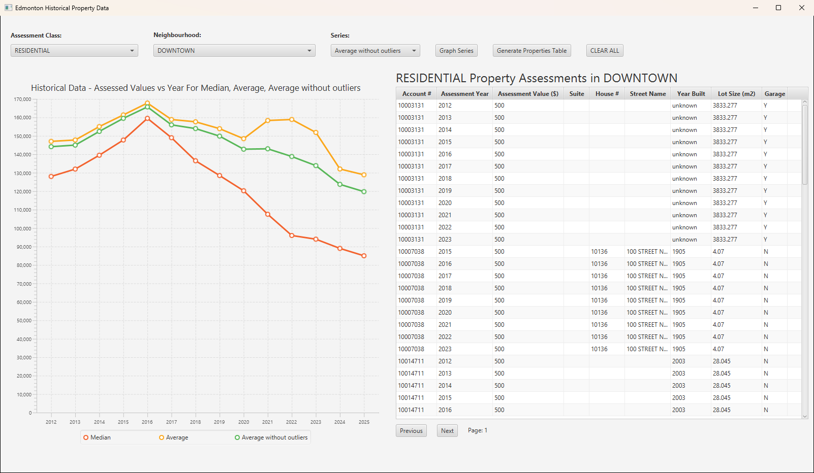

# Edmonton Property Dashboard

A JavaFX desktop app for exploring how Edmonton's property assessments have changed over time. Pick
an assessment class and a neighbourhood, then graph assessed values by year or browse the matching
properties. The data comes live from the City of Edmonton's Open Data portal.

We built it as our final project for CMPT 305 at MacEwan University in 2024.



## Features

- Filter by assessment class (residential, commercial and so on) and neighbourhood. The
  neighbourhood list is searchable.
- Graph assessed values for each year as a sum, average, average without outliers or median, and
  layer several series on one chart to compare them. Outliers are values more than 1.5 times the
  interquartile range below the first quartile or above the third.
- Browse the matching properties 100 at a time, with each property's account number, assessment
  year, assessed value, address, year built, lot size and garage.
- Data loads in the background with a status message, so the window stays responsive.

## Data

The app queries the City of Edmonton's
[Property Assessment Data (Historical)](https://data.edmonton.ca/d/qi6a-xuwt) dataset, which covers
2012 onward, through its Socrata API. It counts only properties assessed entirely in one class, and
skips assessments of $0.

Every request goes to the live API, so the app needs an internet connection. The median and the
average without outliers download every assessed value in the selection, so they can take up to a
minute for large neighbourhoods like Downtown.

## Getting started

You'll need JDK 21 or newer. The Maven wrapper downloads Maven, JavaFX and the other dependencies
the first time you run it.

```sh
git clone https://github.com/aidenj1808/edmonton-property-dashboard.git
cd edmonton-property-dashboard
./mvnw javafx:run
```

On Windows, run `mvnw.cmd javafx:run` from Command Prompt or PowerShell instead. If the wrapper
can't find Java, set `JAVA_HOME` to your JDK's folder.

## Tests

```sh
./mvnw test
```

Most of the tests query the live API, so they need an internet connection and take about a minute.

## Project structure

The code is in `src/main/java/com/example/cmpt305finalproject/`:

- `EdmontonHistoricalPropertyDataApp.java` starts the app and opens the window.
- `EdmontonHistoricalPropertyDataController.java` handles the controls, chart and table.
- `DAOs/ApiPropertyAssessmentDAO.java` queries the API and calculates each series.
- `cmpt305/` holds the models for the chart series and table rows.

The window's layout is `edmonton-historical-property-data-view.fxml`, under `src/main/resources/`.

## Built with

Java 21, JavaFX 21, [ControlsFX](https://controlsfx.github.io/), Maven and JUnit 5.

## Team

- Aiden Lumley ([@aidenj1808](https://github.com/aidenj1808))
- Darion Kwasnitza ([@dkwas4236](https://github.com/dkwas4236))
- Andrew Dool ([@andrewdool92](https://github.com/andrewdool92))
